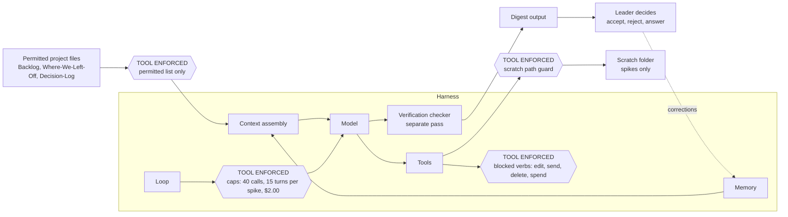

# Juno architecture

Everything here is a design. Nothing is built or tested.

## Components

| Part | What it does | Surface |
|---|---|---|
| Context assembly | Puts the skill file, Definition of Ready and WSJF formula in the prompt; fetches project files on demand | Context |
| Model | Judges readiness, drafts the digest, runs spikes | |
| Tools | read, estimate WSJF, draft digest, recommend and start spikes, write spike report | Tools |
| Loop | One pass per run, at most 3 spikes, stops after 3 failed calls | Loop |
| Memory | Prior digests, spike log, the leader's corrections | Memory |
| Permission tiers | read and draft auto; spikes auto inside the limits; write and send blocked | Permissions |
| Checker | Compares every cited claim to the real file | Verification |

## Data

Juno reads only the three journal files in each permitted project, live on every run. It writes in two places: spike work goes to the scratch folder, and digests go to the digest folder. It keeps the last 4 digests (stale after 7 days), the spike log (findings stale after 14 days, open questions until answered) and the leader's corrections (90 days). Source files are never cached. A stale entry is labelled stale, never used as current.

## Decisions that matter

1. **Split archetype.** The digest is a copilot and the spike runner is a supervised agent. I rejected one agent for everything because spikes carry the cost and write risk, and they should earn their freedom through evals separately.
2. **Live reads, no index.** The files are small and change daily. An index would be a second copy with no sync story.
3. **Guards in the tool, not the prompt.** A prompt can be talked out of a rule by text in a backlog. A path check or a missing verb cannot.

A separate checker follows from decision 3: the writer does not grade itself.

## Not designed yet

- Where the Definition of Ready lives.
- How the checker works and whether it uses a different model.
- Who schedules a run, and what happens if two runs overlap.
- How the leader's corrections are captured.
- A scan for instruction-like text in project files.
- Running with no credentials in reach.

I could not verify any cap or guard, because no code exists. The cost figures are placeholders until Module 4.
